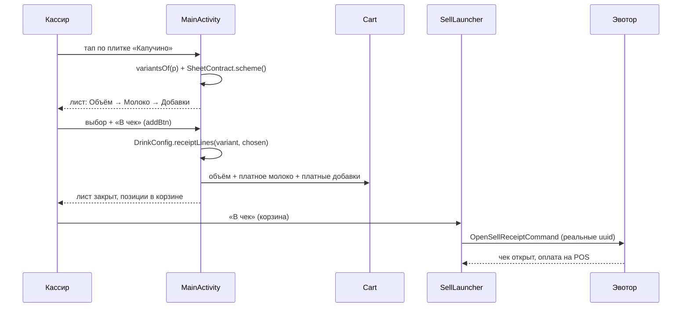

# Динамическая конфигурация напитков (объём · молоко · добавки)

Документ описывает, как касса 6.7 Coffee (APK `ru.sixthcup.evotor`) получает конфигурацию товара,
показывает её кассиру и собирает позиции чека. Версия: **5.2.23 / 149**.

## 1. Что уже было в проекте (аудит)

| Механизм | Факт |
|---|---|
| Каталог | `GET /api/devices/catalog` → `CatalogApi.Payload`; локальная номенклатура — `InventoryRepository` (`ProductTable`) |
| Режимы витрины | `features.serverCatalog = true` → `ServerCatalog`, иначе `CatalogApi.mergeWithStats` |
| Варианты объёма | `DrinkVariants` + `CatalogProduct.variantGroup`/`sizeMl`; **каждый размер — отдельный товар Эвотор со своим uuid** |
| Добавки | `toppings[]` из каталога (`ToppingJson`), группы `groupKey`: `milk` / `syrup` / `sugar` / `extra` |
| Схема листа | `SheetContract.scheme()` → `OK` / `EMPTY_IN_DATA` / `MAPPING_ERROR` |
| Окно выбора | `OptionPicker` внутри `showItemSheet`: секции «Объём → Молоко → Сироп → Сахар → Добавки» |
| Чек | `Cart` → `SellLauncher` → `OpenSellReceiptCommand` (Evotor integration-library) |

Вывод аудита: отдельный «configuration endpoint» в проекте **отсутствует**, и придумывать его
нельзя (ТЗ §2). Все три группы уже приходят в существующем контракте каталога:
объёмы — `groups[]` + `products[]` одной карточки, молоко и добавки — `toppings[]` продукта
с признаком `groupKey`. Поэтому реализация не добавляет ни нового API-клиента, ни второй модели
товара, а закрывает разрывы в правилах.

## 2. Что изменено

| Файл | Изменение |
|---|---|
| `data/InventoryRepository.kt` | `Topping.sendToReceipt` — явный флаг сервера «отправлять ли позицию в чек» |
| `data/ToppingJson.kt` | разбор и сохранение `sendToReceipt` (нет поля → `true`, обратная совместимость) |
| `data/DrinkConfig.kt` (новый) | чистая сборка строк чека из выбора: объём, платное молоко, добавки; правила исключения |
| `ui/OptionPicker.kt` | `Opt.toTopping(groupKey)` и `chosenToppings()` — выбор в доменных терминах |
| `ui/MainActivity.kt` | `addBtn` собирает чек через `DrinkConfig.receiptLines`; защита от двойного нажатия (`sheetAdding`); лог `receipt_lines` |

Не менялись: `SellLauncher`, `Fiscal*`, `DiscountIntegrationService`, scanner, лояльность,
`CatalogApi.mergeWithStats`, backend.

## 3. Три независимые группы

Наличие каждой группы определяет товар; пустые группы в окне не рисуются.

| Группа | Источник | В чек |
|---|---|---|
| Объёмы | `groups[]` карточки + `products[]` размеров | **сам товар размера** (`variant.uuid`) — одна строка |
| Молоко (`groupKey = milk`) | `toppings[]` продукта | платное и с uuid — отдельная позиция; обычное (`zeroOption`) — **нет** |
| Добавки (`syrup`/`sugar`/`extra`) | `toppings[]` продукта | платные с uuid — отдельными позициями |

Пример ответа (поля — фактические, `toppings[]` внутри `products[]`):

```json
{
  "features": { "serverCatalog": true },
  "products": [
    {
      "productId": 501, "evotorUuid": "VOLUME-250-UUID", "name": "Капучино 250 мл",
      "groupId": 77, "sizeValue": 250, "sellable": true,
      "toppings": [
        { "id": 1, "name": "Обычное молоко", "price": 0, "groupKey": "milk",
          "zeroOption": true, "isDefault": true, "sendToReceipt": false, "evotorUuid": "REGULAR-MILK-UUID" },
        { "id": 2, "name": "Кокосовое молоко", "price": 60, "groupKey": "milk",
          "zeroOption": false, "sendToReceipt": true, "evotorUuid": "COCONUT-MILK-UUID" },
        { "id": 3, "name": "Ванильный сироп", "price": 50, "groupKey": "syrup",
          "zeroOption": false, "sendToReceipt": true, "evotorUuid": "VANILLA-SYRUP-UUID" }
      ]
    },
    { "productId": 502, "evotorUuid": "VOLUME-350-UUID", "name": "Капучино 350 мл", "groupId": 77, "sizeValue": 350 }
  ]
}
```

Важно: в `products[]` каждого размера лежит **полный** `toppings[]`. В `groups[].variants[]` добавок
обычно нет, и в server-режиме касса из них ничего не берёт (`CHANGES-FROM-PLAN` F3).

## 4. Правила обычного и платного молока

Бесплатность определяется **только явными флагами конфигурации**, не названием и не ценой:

- `zeroOption: true` → вариант показывается, выбирается по умолчанию (`isDefault`), участвует
  в подписи рецепта, **в чек не идёт** и цену не добавляет;
- `sendToReceipt: false` → вариант можно выбрать, но позиция в чек не отправляется (учётные опции);
- платное молоко (`zeroOption = false`, `sendToReceipt = true`, `evotorUuid != null`) → отдельная
  позиция чека с uuid и ценой из номенклатуры.

## 5. Таблица соответствия параметров

| Параметр | Показывается | UUID | В чек | Цена |
|---|---|---|---|---|
| Объём | да | да (uuid размера) | сам товар размера, одна строка | из каталога/номенклатуры |
| Обычное молоко | да | может быть | **нет** | 0, не добавляется |
| Платное молоко | да | обязательно | отдельная позиция | из номенклатуры |
| Платная добавка | да | обязательно | отдельная позиция | из номенклатуры |
| Опция без uuid | да (с пометкой «нет в кассе») | нет | нет | — |

Формула итога (сверяется с фактической логикой кассы):

$$
P_{\text{итого}} =
P_{\text{объём}} +
\sum_{i \in \text{молоко}} P_i \cdot [\text{sendToReceipt}_i] +
\sum_{j \in \text{добавки}} P_j \cdot [\text{sendToReceipt}_j]
$$

Двойного учёта нет: объём — это и есть базовый товар, отдельная строка «напиток» не создаётся.

## 6. Последовательность работы



## 7. Ошибки, офлайн и защита

| Ситуация | Поведение |
|---|---|
| Сервер недоступен | работаем на кэше каталога (`CatalogCache`), плашка «Сохранённые данные от HH:MM» |
| Пустой ответ | кэш не затирается |
| Схема не сопоставлена | `SheetContract.MAPPING_ERROR` → в листе текст про несоответствие, плитка не блокирует продажу |
| Опция без uuid | показывается как недоступная, в чек не идёт |
| Повторный тап «В чек» в листе | `sheetAdding` — второе нажатие игнорируется |
| Повторное открытие листа | состояние не переносится, выбор начинается с объёма по умолчанию |
| Закрытие без подтверждения | в корзину ничего не добавляется |

## 8. Совместимость

- Старый backend без `sendToReceipt` → `true`, поведение как раньше.
- Старый кэш → те же дефолты.
- Товар без `toppings[]` → лист показывает только объёмы (или сразу добавляет товар).
- Товар без группы молока → секции молока нет.
- `serverCatalog = false` → прежний merge-путь; правила чека те же (они не зависят от режима витрины).

## 9. Тесты

`DrinkConfigTest` — 13 тестов на сценарии A–H из ТЗ §12:
объём как базовая строка, обычное молоко не в чеке и без денег, платное молоко отдельной позицией
с ценой, товар без молока/добавок/объёма, опция без uuid, недоступная опция, `sendToReceipt=false`,
дубль одной позиции, совпадение с uuid объёма, итог = сумма цен, `milk` по `groupKey`.

Полный прогон: **384 теста / 0 падений**, `lintDebug` — 0 ошибок.

## 10. Ограничения и что проверить на кассе

1. Реальная фискализация проверяется только на терминале: `logcat -s SC_TOP` и чек на бумаге.
2. Обновление конфигурации приходит вместе с каталогом (раз в 60 с в фоне); отдельного «живого»
   запроса конфигурации по товару нет — это осознанно, чтобы не плодить второй API-клиент.
3. Если сервер пришлёт молоко отдельной схемой (не в `toppings[]`), потребуется расширение
   контракта и разбор — сейчас такого поля в API нет.

## 11. Конфигурация по запросу (5.2.16, ужесточено в 5.2.17)

Помимо каталога, касса запрашивает конфигурацию конкретной карточки в момент нажатия:

```
GET /api/devices/products/{productId}/configuration?storeUuid={storeUuid}
```

- транспорт тот же: `BuildConfig.API_BASE_URL` + `DeviceHeaders.apply(conn)` + `X-Evotor-Store-Uuid`,
  авторизацию добавляет прокси Evotor Cloud, в APK токенов нет;
- таймауты: connect 5 с, read 10 с; только фоновый поток;
- модели: `ProductConfig → VolumeOption / MilkConfig→MilkOption / AdditionsConfig→AdditionOption`;
- `schemaVersion != 1`, чужая `storeUuid`, битый JSON → конфигурация не применяется;
- **404** = маршрут ещё не реализован на backend → работаем по каталогу, как раньше;
- кэш `storeUuid + productId` (`ProductConfigCache`) переживает офлайн; плашка
  «Конфигурация с сервера недоступна — используются сохранённые данные»;
- ошибка без кэша: окно всё равно открывается по данным каталога (обязательное молоко
  проверяется тем же `ToppingRules`), товар не добавляется молча;
- защита: двойной тап по карточке игнорируется (`configLoadingUuid`), ответ для закрытой
  карточки отбрасывается (`configGen`), конфигурация живёт до закрытия листа.

Порядок блока в окне: **объём → молоко → добавки**; при схеме молока `required=true`
все её варианты помечаются обязательными, поэтому «В чек» блокируется до выбора.

## 12. Строгая проверка ответа и запрет обхода (5.2.17)

Обязательные поля ответа проверяются по типу и значению; отсутствующее поле **не подменяется**
ожидаемым — такая конфигурация отклоняется целиком:

| Поле | Требование | Отказ |
|---|---|---|
| `storeUuid` | присутствует, строка, непустая, совпадает с магазином запроса | `config_store_missing` / `config_store_mismatch` |
| `productId` | присутствует, число (не строка), > 0, равно запрошенному | `config_product_missing` / `config_product_mismatch` |
| `schemaVersion` | ровно `1` | `config_schema_mismatch` |

Отказ означает `config = null`, поэтому `ProductConfigPolicy.silentAddAllowed` = `false`:
товар открывается окном, молчаливое добавление в чек невозможно.

Пути добавления и их защита:

| Путь | Поведение |
|---|---|
| тап по плитке | `openProduct` → запрос конфигурации → окно или добавление |
| «+» на плитке | тот же `openProduct`; быстрое добавление только после подтверждения «схем нет» (`silentAddByUuid`) |
| повторный тап по карточке | `configLoadingUuid` — второй запрос не создаётся |
| повторное добавление / «+» в корзине | количество у существующей строки, состав опций не меняется |
| 404 / 403 / 500 / таймаут / битый JSON | окно по каталогу, прямое добавление запрещено |
| кэш `storeUuid + productId` | старше `ProductConfigCache.MAX_AGE_MS` (24 ч) не используется (`config_cache_stale`) |

Схемы строго по объёму (`ProductConfigGuard`):

- `volumeProductId` ищет объём по Evotor UUID товара; чужой/неизвестный объём → `null`;
- нет схемы молока у объёма при `milk.required=true` → «Нет схемы молока для объёма — продажа запрещена»;
- обязательная добавка без доступных опций → «Обязательные добавки недоступны — продажа запрещена»;
- схема соседнего размера и `cfg.productId` как запасной вариант **не подставляются**.

Правила окна вынесены в чистый `ConfigOptsMapper` (без Android), поэтому тесты проверяют
ровно тот код, который работает на кассе: `ConfigOptsMapperTest` (14 тестов) + `ToppingRules.blockers`.

Ограничение (требует корректной конфигурации на backend): если объём товара не связан
с `evotorUuid` в ответе, продажа этого размера блокируется сообщением «Объём не опознан» —
это осознанно: подставлять схему другого размера нельзя.

## 13. «Повторить», путь «В чек» и построитель позиций (5.2.18)

**«Повторить» на пустом чеке** больше не копирует прошлый чек: `Cart.repeatLast()` удалён,
`Cart.lastOrderLines()` только читает сохранённые строки, а решение принимает
`RepeatOrder.plan(lastOrder, catalog, noConfigConfirmed)`:

| Строка прошлого чека | Что делает касса |
|---|---|
| обычный товар, сервер подтвердил «схем нет» | восстанавливается как есть (`Restore`) |
| обычный товар, схемы не подтверждены / молоко обязательно / сервер недоступен | идёт в очередь `NeedsChoice` → `openProduct` (тот же путь, что по тапу на плитку) |
| строка с `optionId` (платное молоко, добавка) | не восстанавливается: выбирается заново в окне (`Skip`) |
| комбо-группа | не восстанавливается построчно (`Skip`) |
| товара больше нет в каталоге / `mod:`-строка | не восстанавливается (`Skip`) |

Позиции из очереди открываются по одной: после добавления строки в корзину
(`openProductLegacy` или «В чек» в окне) вызывается `openNextRepeatItem()`.

**От «В чек» до Эвотор** (единый путь, всё покрыто тестами):

```
showItemSheet «В чек»
  → CartLines.of(variant, picker.chosenToppings(), modsText, signature, qty)   // чистая
  → Cart.add
  → (оплата) ReceiptValidator.validate   // удалённый товар / опция без uuid — до чека
  → SellLauncher.openSellReceipt
      → FiscalLines.build (раскладка льготы по позициям)
      → ReceiptPlan.plan(fiscalLines, terminal)   // чистая: uuid, цена терминала, скидка
      → Position.Builder.newInstance(item, qty).setPrice(...) / setPriceWithDiscountPosition(...)
```

Правила `ReceiptPlan`: синтетические uuid (`mod:…`) не продаются, цена берётся из номенклатуры
терминала (расхождение только логируется), `priceWithDiscountPosition` ставится лишь когда цена
ниже, количество и uuid не переписываются. Бесплатное молоко и `sendToReceipt=false` до этого
этапа вообще не доходят — их отсекает `DrinkConfig` внутри `CartLines`.

Тесты боевого пути: `ReceiptPlanTest` (12) и `RepeatOrderTest` (8); они вызывают те же
`CartLines`/`ReceiptPlan`, что и `MainActivity`/`SellLauncher`.

## 14. Блокировка чека без товара в кассе и завершение повтора (5.2.19)

**Никаких «ручных» позиций.** Конструктор
`Position.Builder.newInstance(uuid, productUuid, name, Measure, price, quantity)` в
integration-library v0.6.27 (проверено `javap -c`) создаёт позицию с жёстко заданным
`ProductType.NORMAL` и `TaxNumber = null`. Фискальные признаки для такой строки не
гарантированы, поэтому fallback удалён:

- `ReceiptPlan.plan` не создаёт позицию, если `InventoryApi.getProductByUuid` не нашёл товар:
  строка попадает в `missing`;
- `ReceiptPlan.blockReason(plan)` возвращает текст с наименованием и **uuid** отсутствующего
  товара; `SellLauncher` вызывает его до `CheckoutChoice.save` и до
  `OpenSellReceiptCommand.process` → позиции в Эвотор не передаются, частичной продажи нет;
- `Outcome.blockedBeforeSend = true` — касса снимает зарезервированный номер очереди
  (`QueueNumberStore.clear`) и не помечает заказ как PENDING.

**Порядок оплаты (фактический):** `«В чек»` → `openLoyaltyOrSend` → `sendChosen` →
`sendReceipt` → `ReceiptValidator.validate` (удалённый товар, опция без uuid — блок) →
`requestQueueNumberBlocking` → `SellLauncher.openSellReceipt` → `ReceiptPlan.plan` +
`blockReason` (нет товара в терминале — блок) → `OpenSellReceiptCommand.process`.

**Очередь «Повторить»** — `RepeatSession` (чистый класс):

| Событие | Поведение |
|---|---|
| `start(items)` | новая очередь; старая очищается, ничего не смешивается |
| позиция добавлена (`added`) | только теперь открывается следующая |
| окно закрыто без добавления (`closedWithoutAdd`) | очередь не продвигается, `incomplete = true`, касса показывает «Повтор не завершён: осталось N поз.» и спрашивает: «Продолжить повтор» / «Отменить повтор» |
| ошибка конфигурации | позиция остаётся текущей: следующая не открывается, пока позиция не добавлена |
| ручное добавление другого товара | очередь не трогается (`added`/`closedWithoutAdd` возвращают «не наша позиция») |
| `cancel()` | остаток отменяется, касса пишет, сколько позиций не добавлено |

Кнопка «Повторить» на пустом чеке во время незавершённого повтора превращается в
«Отменить повтор».

## 15. Жизненный цикл повтора и проверка номенклатуры до номера (5.2.20)

**Диалог «Повтор не завершён»** больше не всплывает поверх другой карточки:

- закрытие окна (крестик, Back, тап мимо) → `RepeatSession.closedWithoutAdd` → уведомление
  `RepeatInterrupt.notice(...)` и отложенная на `REPEAT_INTERRUPT_DELAY_MS` (300 мс) проверка;
- `RepeatInterrupt.shouldShow(pending, sheetOpen, dialogShowing)` — диалог показывается только
  если прерывание есть, лист поверх каталога закрыт и диалог ещё не открыт;
- `catalogSheetOpen` выставляется карточкой товара, комбо-листом и листом клиента;
  после их закрытия проверка планируется заново;
- повторный вызов обработчика закрытия невозможен: у каждого листа `closedOnce`,
  а `closedWithoutAdd` игнорирует «не нашу» позицию;
- отмена (`Отменить повтор`) очищает очередь и ничего не открывает;
- кнопка на пустом чеке во время сессии показывает «Продолжить повтор» и повторно открывает
  диалог «Продолжить / Отменить» (два диалога одновременно не создаются).

**Номенклатура проверяется до резервирования номера очереди** (`sendReceipt`):

```
ReceiptValidator.validate        (каталог: удалённый товар, опция без uuid)
ReceiptPlan.cartUuids(Cart.all()) → InventoryApi.getProductByUuid по каждому uuid
  missing.isNotEmpty() → уведомление с uuid, перезагрузка каталога, return   // номер не тратится
sendingReceipt = true → CheckoutChoice.saveCombo → requestQueueNumberBlocking() → SellLauncher
```

`SellLauncher` принимает уже найденные позиции (`preflight`) и **всё равно** проверяет
`ReceiptPlan.blockReason` как вторую линию защиты — позиции в Эвотор уходят только после обеих.

## 16. Диагностика прямо в окне товара (5.2.21)

На терминале нет доступа к `logcat`, поэтому причина «в окне только объём» печатается текстом
под блоком выбора (`ConfigDiagnostics.hint`), а также в лог (`config_hint <uuid> text=…`):

| Причина | Текст в окне |
|---|---|
| нет `productId` (каталог не сопоставил товар) | «Схема не запрошена: товар не сопоставлен с сервером (нет productId). Обновите каталог.» |
| не определён UUID точки | «Схема не запрошена: не определён UUID точки.» |
| маршрута конфигурации нет на backend | «Сервер не отдаёт конфигурацию товара (HTTP 404) — окно работает по каталогу.» |
| ответ пришёл из кэша, схем нет | «Схема не назначена (используются сохранённые данные с сервера).» |
| сеть/ошибка сервера | «Схема не получена: сервер недоступен. Проверьте связь и повторите.» |
| схемы есть, объём не связан с `evotorUuid` | «Для этого объёма схема не назначена (объём не сопоставлен с сервером).» |
| схема есть, но опции недоступны | «Схема есть, но опции недоступны (нет товаров Эвотор).» |
| схемы нет вовсе | «Молоко и добавки не назначены: у товара нет схемы на сервере.» |

Подсказка не показывается, если в окне уже есть опции (молоко/добавки) или топпинги каталога.

Дополнительно: `ProductConfigGuard.appliesTo` — если backend прислал схемы, но не связал
объёмы с `evotorUuid`, конфигурация всё равно считается относящейся к карточке (совпадение
`productId`), поэтому продажа блокируется сообщением «Объём не опознан», а не уходит молча
по каталогу. Конфигурация без схем (только объёмы) каталог не блокирует.

## 17. Синхронизация с backend (5.2.22)

Backend реализовал `GET /api/devices/products/:productId/configuration` (без `Authorization`,
как `/catalog`). Что доделано в кассе:

- **`X-App-Version-Code` и `X-App-Version-Name`** добавлены в `DeviceHeaders.apply`, поэтому их
  видят `/catalog`, `/configuration`, loyalty, смены и номер очереди. Backend по версии включает
  `features.serverCatalog=true` — на 148 режим серверной витрины активен, это надо проверить на кассе;
- **`200 {ok:false, error:"product_not_found"}`** — не «нет маршрута» и не «схем нет»: касса
  отклоняет конфигурацию, окно открывается по каталогу, а кассир видит
  «Товар не найден на сервере — обновите каталог» (`ConfigDiagnostics.errorText`);
- коды `store_required`, `invalid_product_id`, `proxy_forbidden`, `store_uuid_mismatch`
  переведены в понятные фразы (иначе в уведомление попадал английский код);
- схема `{schemeId:null, options:[]}` = «схема не назначена»: `milk`/`additions` для такого объёма
  не рисуются, `config.milk`/`config.additions` остаются `null`, если пусто у всех объёмов.

**Риск перед деплоем:** касса сопоставляет объёмы по `volumes[].evotorUuid`. Если в проде
`product_store_links` для объёма не заполнены, `evotorUuid=null` → продажа этого размера
блокируется фразой «Объём не опознан: выберите другой размер» (это осознанно: чужую схему
подставлять нельзя). Перед включением маршрута надо проверить связи «товар → uuid Эвотор»
по каждой точке.

## 18. Откат серверной витрины (5.2.23)

Симптом после 5.2.22 (когда касса начала отправлять `X-App-Version-Code` и backend включил
`features.serverCatalog`): все объёмы капучино стали отдельными плитками, в карточке исчез блок
«Объём», добавки не приходили.

Причина: `ServerCatalog.build` строит витрину строго из серверного JSON — без склейки размеров
по меткам `#group=/#size=` и без донора схем. Пока каталог на сервере не готов к этому режиму,
витрина рассыпается.

Решение: `CatalogMode.useServerCatalog(...)` — флаг backend **игнорируется**, пока
`SERVER_CATALOG_ALLOWED = false` (касса продолжает отправлять заголовок версии, но витрину строит
прежней склейкой). Включение — одной константой после проверки каталога на кассе.
