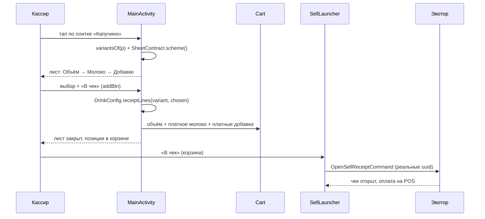

# Динамическая конфигурация напитков (объём · молоко · добавки)

Документ описывает, как касса 6.7 Coffee (APK `ru.sixthcup.evotor`) получает конфигурацию товара,
показывает её кассиру и собирает позиции чека. Версия: **5.2.16 / 142**.

## 1. Что уже было в проекте (аудит)

| Механизм | Факт |
|---|---|
| Каталог | `GET /api/devices/catalog` → `CatalogApi.Payload`; локальная номенклатура — `InventoryRepository` (`ProductTable`) |
| Режимы витрины | `features.serverCatalog = true` → `ServerCatalog`, иначе `CatalogApi.mergeWithStats` |
| Варианты объёма | `DrinkVariants` + `CatalogProduct.variantGroup`/`sizeMl`; **каждый размер — отдельный товар Эвотор со своим uuid** |
| Добавки | `toppings[]` из каталога (`ToppingJson`), группы `groupKey`: `milk` / `syrup` / `sugar` / `extra` |
| Схема листа | `SheetContract.scheme()` → `OK` / `EMPTY_IN_DATA` / `MAPPING_ERROR` |
| Окно выбора | `OptionPicker` внутри `showItemSheet`: секции «Объём → Молоко → Сироп → Сахар → Добавки» |
| Чек | `Cart` → `SellLauncher` → `OpenSellReceiptCommand` (Evotor integration-library) |

Вывод аудита: отдельный «configuration endpoint» в проекте **отсутствует**, и придумывать его
нельзя (ТЗ §2). Все три группы уже приходят в существующем контракте каталога:
объёмы — `groups[]` + `products[]` одной карточки, молоко и добавки — `toppings[]` продукта
с признаком `groupKey`. Поэтому реализация не добавляет ни нового API-клиента, ни второй модели
товара, а закрывает разрывы в правилах.

## 2. Что изменено

| Файл | Изменение |
|---|---|
| `data/InventoryRepository.kt` | `Topping.sendToReceipt` — явный флаг сервера «отправлять ли позицию в чек» |
| `data/ToppingJson.kt` | разбор и сохранение `sendToReceipt` (нет поля → `true`, обратная совместимость) |
| `data/DrinkConfig.kt` (новый) | чистая сборка строк чека из выбора: объём, платное молоко, добавки; правила исключения |
| `ui/OptionPicker.kt` | `Opt.toTopping(groupKey)` и `chosenToppings()` — выбор в доменных терминах |
| `ui/MainActivity.kt` | `addBtn` собирает чек через `DrinkConfig.receiptLines`; защита от двойного нажатия (`sheetAdding`); лог `receipt_lines` |

Не менялись: `SellLauncher`, `Fiscal*`, `DiscountIntegrationService`, scanner, лояльность,
`CatalogApi.mergeWithStats`, backend.

## 3. Три независимые группы

Наличие каждой группы определяет товар; пустые группы в окне не рисуются.

| Группа | Источник | В чек |
|---|---|---|
| Объёмы | `groups[]` карточки + `products[]` размеров | **сам товар размера** (`variant.uuid`) — одна строка |
| Молоко (`groupKey = milk`) | `toppings[]` продукта | платное и с uuid — отдельная позиция; обычное (`zeroOption`) — **нет** |
| Добавки (`syrup`/`sugar`/`extra`) | `toppings[]` продукта | платные с uuid — отдельными позициями |

Пример ответа (поля — фактические, `toppings[]` внутри `products[]`):

```json
{
  "features": { "serverCatalog": true },
  "products": [
    {
      "productId": 501, "evotorUuid": "VOLUME-250-UUID", "name": "Капучино 250 мл",
      "groupId": 77, "sizeValue": 250, "sellable": true,
      "toppings": [
        { "id": 1, "name": "Обычное молоко", "price": 0, "groupKey": "milk",
          "zeroOption": true, "isDefault": true, "sendToReceipt": false, "evotorUuid": "REGULAR-MILK-UUID" },
        { "id": 2, "name": "Кокосовое молоко", "price": 60, "groupKey": "milk",
          "zeroOption": false, "sendToReceipt": true, "evotorUuid": "COCONUT-MILK-UUID" },
        { "id": 3, "name": "Ванильный сироп", "price": 50, "groupKey": "syrup",
          "zeroOption": false, "sendToReceipt": true, "evotorUuid": "VANILLA-SYRUP-UUID" }
      ]
    },
    { "productId": 502, "evotorUuid": "VOLUME-350-UUID", "name": "Капучино 350 мл", "groupId": 77, "sizeValue": 350 }
  ]
}
```

Важно: в `products[]` каждого размера лежит **полный** `toppings[]`. В `groups[].variants[]` добавок
обычно нет, и в server-режиме касса из них ничего не берёт (`CHANGES-FROM-PLAN` F3).

## 4. Правила обычного и платного молока

Бесплатность определяется **только явными флагами конфигурации**, не названием и не ценой:

- `zeroOption: true` → вариант показывается, выбирается по умолчанию (`isDefault`), участвует
  в подписи рецепта, **в чек не идёт** и цену не добавляет;
- `sendToReceipt: false` → вариант можно выбрать, но позиция в чек не отправляется (учётные опции);
- платное молоко (`zeroOption = false`, `sendToReceipt = true`, `evotorUuid != null`) → отдельная
  позиция чека с uuid и ценой из номенклатуры.

## 5. Таблица соответствия параметров

| Параметр | Показывается | UUID | В чек | Цена |
|---|---|---|---|---|
| Объём | да | да (uuid размера) | сам товар размера, одна строка | из каталога/номенклатуры |
| Обычное молоко | да | может быть | **нет** | 0, не добавляется |
| Платное молоко | да | обязательно | отдельная позиция | из номенклатуры |
| Платная добавка | да | обязательно | отдельная позиция | из номенклатуры |
| Опция без uuid | да (с пометкой «нет в кассе») | нет | нет | — |

Формула итога (сверяется с фактической логикой кассы):

$$
P_{\text{итого}} =
P_{\text{объём}} +
\sum_{i \in \text{молоко}} P_i \cdot [\text{sendToReceipt}_i] +
\sum_{j \in \text{добавки}} P_j \cdot [\text{sendToReceipt}_j]
$$

Двойного учёта нет: объём — это и есть базовый товар, отдельная строка «напиток» не создаётся.

## 6. Последовательность работы



## 7. Ошибки, офлайн и защита

| Ситуация | Поведение |
|---|---|
| Сервер недоступен | работаем на кэше каталога (`CatalogCache`), плашка «Сохранённые данные от HH:MM» |
| Пустой ответ | кэш не затирается |
| Схема не сопоставлена | `SheetContract.MAPPING_ERROR` → в листе текст про несоответствие, плитка не блокирует продажу |
| Опция без uuid | показывается как недоступная, в чек не идёт |
| Повторный тап «В чек» в листе | `sheetAdding` — второе нажатие игнорируется |
| Повторное открытие листа | состояние не переносится, выбор начинается с объёма по умолчанию |
| Закрытие без подтверждения | в корзину ничего не добавляется |

## 8. Совместимость

- Старый backend без `sendToReceipt` → `true`, поведение как раньше.
- Старый кэш → те же дефолты.
- Товар без `toppings[]` → лист показывает только объёмы (или сразу добавляет товар).
- Товар без группы молока → секции молока нет.
- `serverCatalog = false` → прежний merge-путь; правила чека те же (они не зависят от режима витрины).

## 9. Тесты

`DrinkConfigTest` — 13 тестов на сценарии A–H из ТЗ §12:
объём как базовая строка, обычное молоко не в чеке и без денег, платное молоко отдельной позицией
с ценой, товар без молока/добавок/объёма, опция без uuid, недоступная опция, `sendToReceipt=false`,
дубль одной позиции, совпадение с uuid объёма, итог = сумма цен, `milk` по `groupKey`.

Полный прогон: **326 тестов / 0 падений**, `lintDebug` — 0 ошибок.

## 10. Ограничения и что проверить на кассе

1. Реальная фискализация проверяется только на терминале: `logcat -s SC_TOP` и чек на бумаге.
2. Обновление конфигурации приходит вместе с каталогом (раз в 60 с в фоне); отдельного «живого»
   запроса конфигурации по товару нет — это осознанно, чтобы не плодить второй API-клиент.
3. Если сервер пришлёт молоко отдельной схемой (не в `toppings[]`), потребуется расширение
   контракта и разбор — сейчас такого поля в API нет.

## 11. Конфигурация по запросу (5.2.16)

Помимо каталога, касса запрашивает конфигурацию конкретной карточки в момент нажатия:

```
GET /api/devices/products/{productId}/configuration?storeUuid={storeUuid}
```

- транспорт тот же: `BuildConfig.API_BASE_URL` + `DeviceHeaders.apply(conn)` + `X-Evotor-Store-Uuid`,
  авторизацию добавляет прокси Evotor Cloud, в APK токенов нет;
- таймауты: connect 5 с, read 10 с; только фоновый поток;
- модели: `ProductConfig → VolumeOption / MilkConfig→MilkOption / AdditionsConfig→AdditionOption`;
- `schemaVersion != 1`, чужая `storeUuid`, битый JSON → конфигурация не применяется;
- **404** = маршрут ещё не реализован на backend → работаем по каталогу, как раньше;
- кэш `storeUuid + productId` (`ProductConfigCache`) переживает офлайн; плашка
  «Конфигурация с сервера недоступна — используются сохранённые данные»;
- ошибка без кэша: окно всё равно открывается по данным каталога (обязательное молоко
  проверяется тем же `ToppingRules`), товар не добавляется молча;
- защита: двойной тап по карточке игнорируется (`configLoadingUuid`), ответ для закрытой
  карточки отбрасывается (`configGen`), конфигурация живёт до закрытия листа.

Порядок блока в окне: **объём → молоко → добавки**; при схеме молока `required=true`
все её варианты помечаются обязательными, поэтому «В чек» блокируется до выбора.
